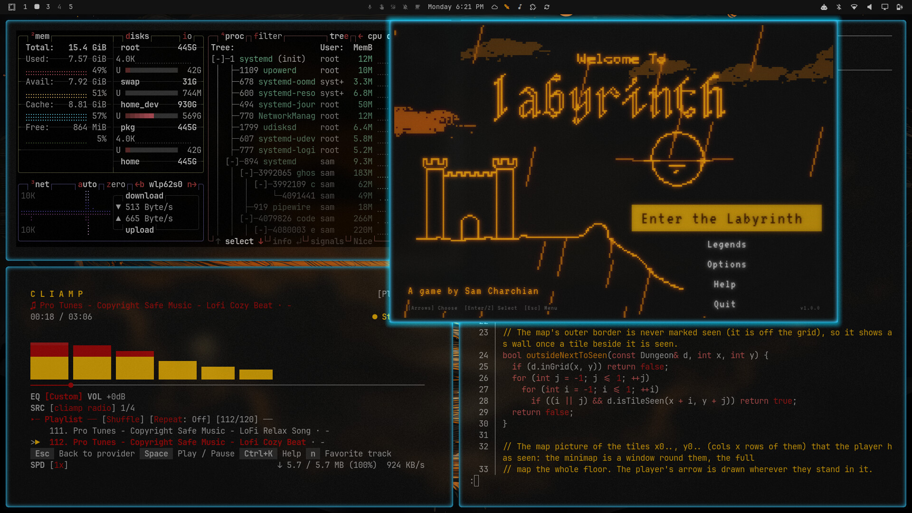
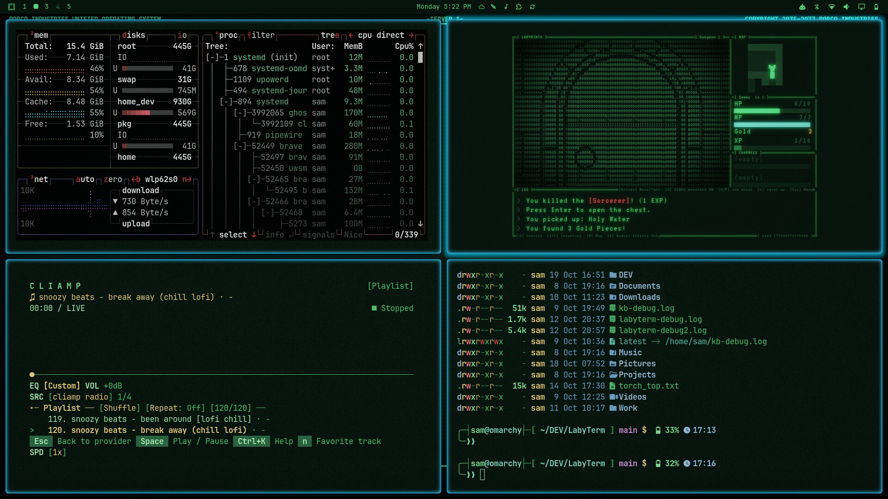
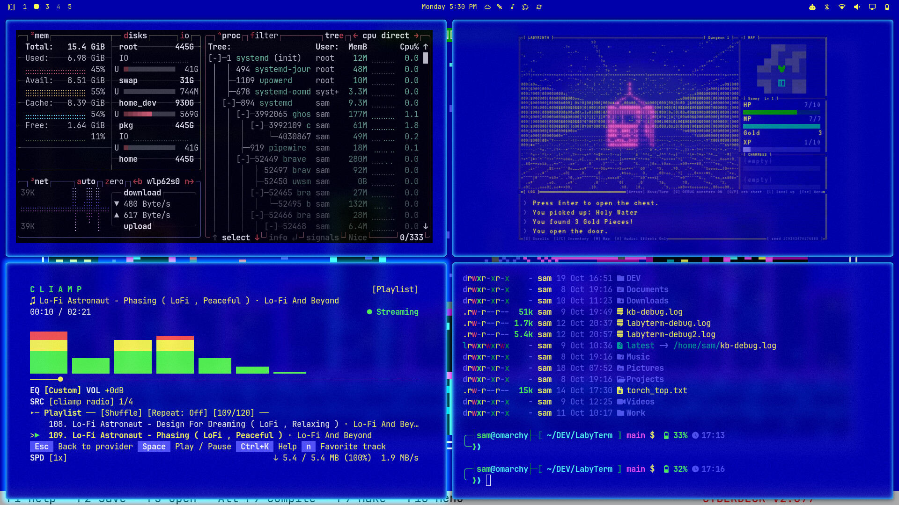
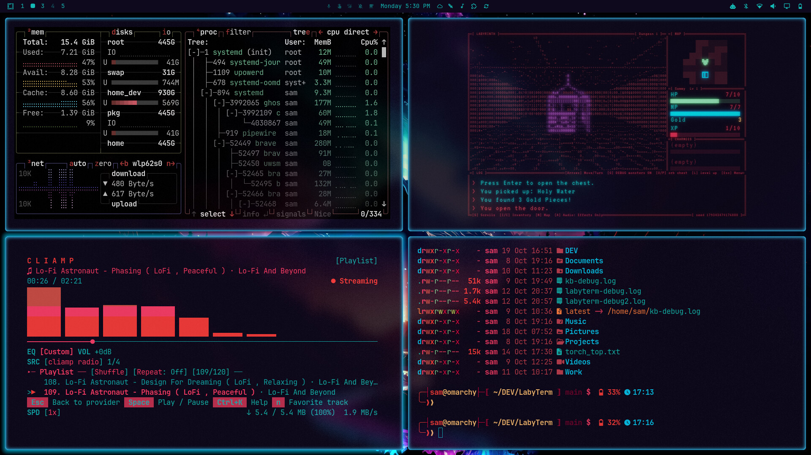
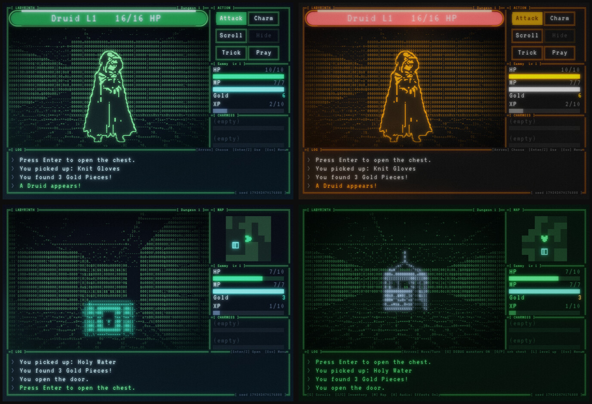
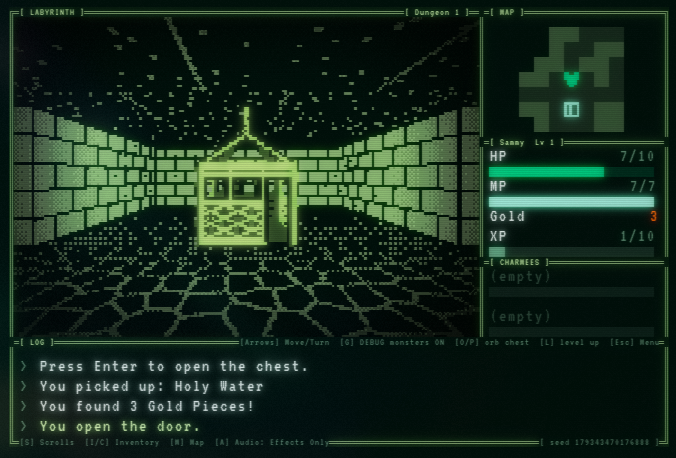

# LabyTerm 
**A first-person roguelike dungeon crawler for Omarchy.** Install it as a plugin, or run it stand-alone.

LabyTerm is a first-person dungeon crawler for your Omarchy desktop with a text-mode look: every cell on screen is a colored character, drawn in its own window. It follows your theme, wears an optional CRT glow, and is easy on the CPU when you leave it open.

It is a spiritual port of [*Labyrinth*](https://play.date/games/labyrinth/), a Playdate game by the same author, which itself grew out of a 1980 game on the CDC PLATO
mainframe. Same dungeon, much more screen.

The Omarchy plugin adds a **bar widget**: click it to start the game, click again to tuck it away, click to bring it back. LabyTerm
drops down as a floating window under the bar, over whatever you are doing, and it is silent while hidden. It is designed to stay
open all day with just a whisper of CPU usage.  Waiting for a compile? Pop open LabyTerm for a few quick turns.

# Install LabyTerm

    omarchy plugin add https://github.com/SCharchian/omarchy-labyterm.git --enable

Then press SUPER+SPACE and search **"LabyTerm"**. Other ways to install, and what the first launch does, are under [Install](#install).

## What you get

- **A real roguelike dungeon crawl**: walk first-person through floors with secret doors, fountains, chests and a boss, then ride the
  elevator deeper. Combat is turn-based (attack, scrolls, charm, trick, pray, hide, flee).
- **Town**: the Temple heals you, the Blacksmith and the BeastMart buy and sell, and the sign post saves your game.
- **Permadeath**: there is no autosave, a save can only load once. A dead hero haunts the floor where he fell; watch out!
  Good runs enter the local Legends leaderboard.
- **It matches your desktop**: colors follow your Omarchy theme live. Switch themes and the dungeon instantly follows.
- **It is made to stay open**: an idle window uses almost 0% CPU.
- **Sound**: the original's effects and music, plus a mute switch for when the boss walks by.

## It wears your desktop

LabyTerm reads your Omarchy theme and recolors itself live: switch themes and the dungeon instantly follows. The same desktop in three themes,
with LabyTerm in the top right. First RobCo, then Borland C and Aetheria:

<table>
<tr>
<td> Borland C</td>
<td> Aetheria</td>
</tr>
</table>

And the game window on its own: a fight with a druid in two themes (top), and two views of the dungeon (bottom).

## Two ways to draw the dungeon

The dungeon is drawn from text characters by default (every shot above). Prefer old-school pixel art?  LabyTerm has you covered!  **Options → Dungeon style** switches it to Pixel Art, which
builds the view out of octant mosaic cells instead:

## Play in your terminal

LabyTerm also plays inside a terminal, with no window at all. Run `labyterm -t` in a terminal that has truecolor and draws Unicode 16 block characters
(Ghostty and foot do; others get a one-time check and a fallback), at least 100 x 30 cells; a bigger window gets more room. `labyterm -w` plays
in the window. Without either, a window opens when there is a display and the terminal is used when there is not (so it works over ssh). Details and
fixes for tmux are in [KNOWN-ISSUES.md](KNOWN-ISSUES.md); `labyterm --help` lists the options.

## Requirements

- Linux with a graphical session (developed and tested on [Omarchy](https://omarchy.org): Arch, Hyprland, Wayland), or a truecolor terminal for `labyterm -t`.
- SDL3 (the `sdl3` package).
- A GPU with Vulkan is optional: it makes the screen filter cheap. Without one the game falls back to the CPU, which works but
  is slower at large window sizes.
- Omarchy is optional. Elsewhere the game uses a built-in palette. See [KNOWN-ISSUES.md](KNOWN-ISSUES.md) for other distros.

## Install

**On Omarchy, as a plugin** (adds a launcher entry and a bar widget):

    omarchy plugin add https://github.com/SCharchian/omarchy-labyterm.git --enable

Then press SUPER+SPACE and search **"LabyTerm"**. The first launch builds the game from source (a few minutes, one `sudo pacman`
prompt for missing build tools). When a new version comes out, LabyTerm offers to rebuild itself the next time you start it.

**From the AUR:** an AUR package (`labyterm`) is planned. Once it exists, the plugin will offer it on first launch, and `yay -Syu`
will keep it current.

**From source:**

    git clone https://github.com/SCharchian/LabyTerm.git && cd LabyTerm
    cmake -S . -B build -G Ninja -DCMAKE_BUILD_TYPE=Release
    cmake --build build --target labyterm
    build/labyterm

To install it as a regular application for your user (a `labyterm` command plus a **LabyTerm** entry in the launcher; make sure `~/.local/bin` is on your `PATH`):

    cmake -S . -B build-release -G Ninja -DCMAKE_BUILD_TYPE=Release
    cmake --build build-release
    cmake --install build-release --prefix ~/.local

For development, `tools/build.sh` builds everything (the game, the tests, the balance bots and the inspection tools) with the DEBUG hotkeys compiled in. More in [docs/DEVELOPING.md](docs/DEVELOPING.md).

**Update**: run `omarchy plugin update io.github.scharchian.labyterm`, then start LabyTerm: it offers to rebuild the game if a newer
version is out (answer "not now" and it asks again for the next version).
**Remove**: `omarchy plugin remove io.github.scharchian.labyterm`, and delete `~/.local/share/labyterm/` (the built game) and `~/.local/bin/labyterm` (the `labyterm` terminal command the plugin writes).
Your saves in `~/.local/state/labyterm/` and settings in `~/.config/labyterm/` are left alone.

## How to play LabyTerm

    labyterm          # a new random game
    labyterm 42       # the same, with a seed (repeatable dungeons)

| Key | Does |
|---|---|
| Arrows | Move and turn (Up/Down also pick in the elevator and in lists) |
| Enter or Z | Confirm |
| Esc | Back out; at the top level, the menu (Options, Help, About, Quit) |
| S | Scrolls |
| I/C | Inventory / Character|
| M | Full map |
| A | Audio: full, effects only, mute |

The keys can be rebound in Options, and the Help screen explains the rest. You make a hero (name, re-rolled stats, starting
item) and drop into the labyrinth.

## Configuration

Everything is optional. The Options menu covers volume, theme, CRT look, key repeat and key bindings. Game balance lives in one
commented file you can override, and a handful of environment variables change window size and paths. See
[docs/CONFIGURATION.md](docs/CONFIGURATION.md).

## Troubleshooting

- **The game feels slow, or CPU use is high**: you probably have no GPU acceleration (a virtual machine, for one). Try
  `LABYTERM_CPU_CRT=1 labyterm`, a lower screen filter in Options, or a smaller window (`LABYTERM_CELL=12`).
- **The window is too big for the screen**: pick a smaller cell size, `LABYTERM_CELL=12 labyterm`.
- **The colors are off**: with no Omarchy theme the game uses its own palette. Point `LABYTERM_THEME_DIR` at a folder with a
  `colors.toml` to use any palette.
- **The first launch from the plugin fails to build**: the terminal waits for a key so you can read the error, and the full
  compiler output is in `~/.local/share/labyterm/build.log`.
- **Anything else**: please [open an issue](https://github.com/SCharchian/LabyTerm/issues).

## What it is not

- It is not a clone of the Playdate game: it keeps the rules and the world, and deliberately departs from the original where
  a big color screen allows.
- The Omarchy plugin (launcher entry, bar widget, themed colors) is Omarchy-only. The game itself should run anywhere SDL3 does,
  but only Omarchy is tested.

## Credits and license

- *Labyrinth* (PLATO, 1980) by Randy Harmelink and Michael Wei
- *Labyrinth* (Playdate) by Sam Charchian, with help from Paul Charchian.
- *LabyTerm* (Omarchy Linux) by Sam Charchian, ported together with Claude (the in-game About page says how). Sound effects are CC0
from Freesound; fonts and other bundled pieces are listed in [THIRD_PARTY.md](THIRD_PARTY.md).

Code is MIT; art, audio and game data are CC BY 4.0: use and change them freely, and credit **Sam Charchian** and **LabyTerm**.
Details in [LICENSING.md](LICENSING.md).
