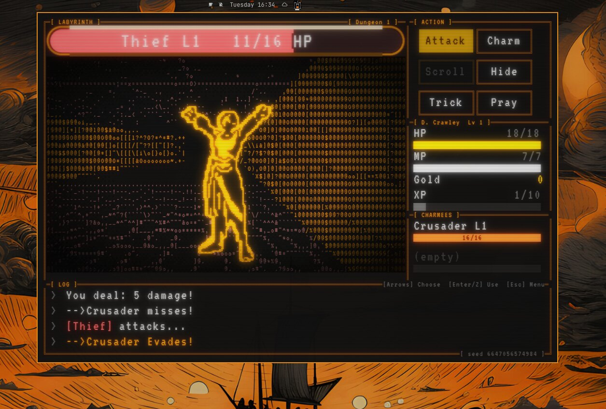
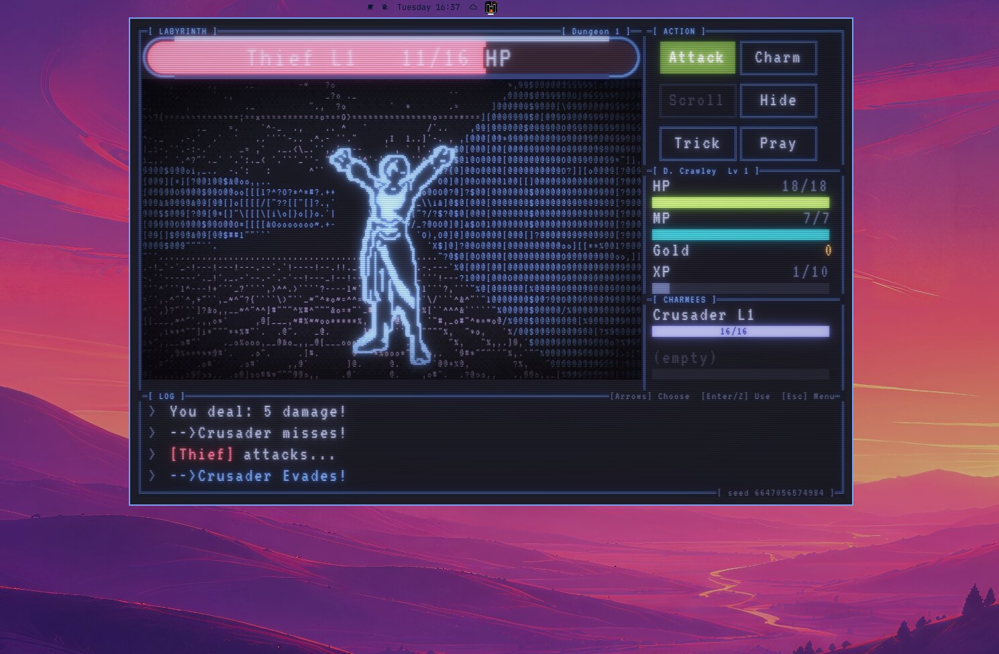
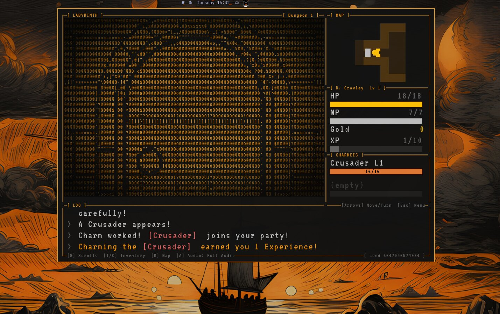
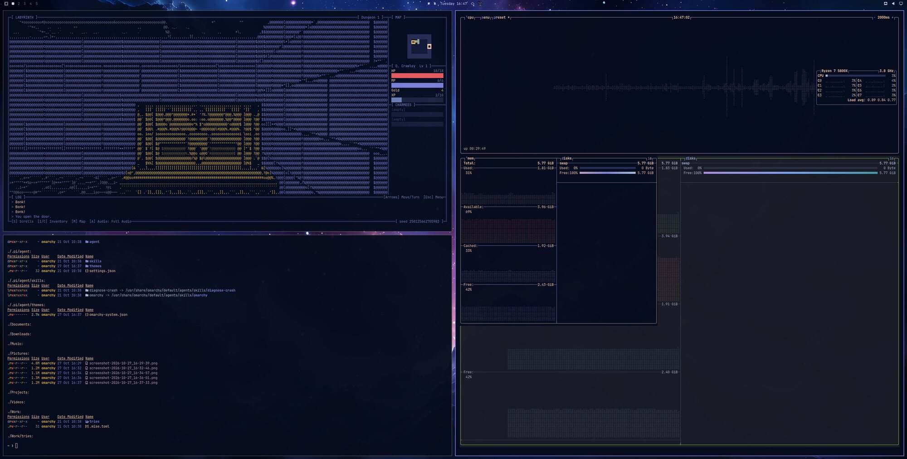
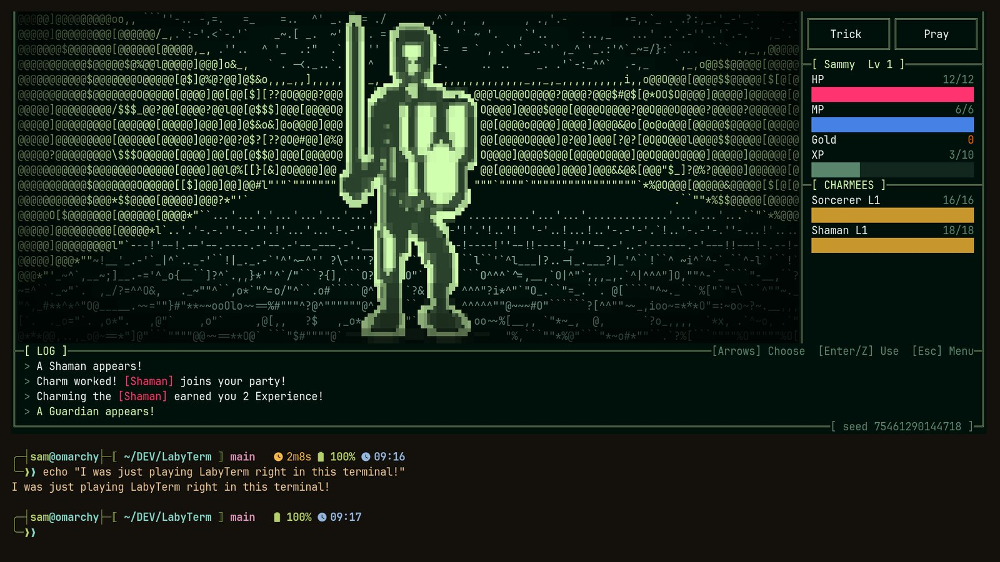

# LabyTerm for Omarchy

**A first-person dungeon crawler, drawn as colored text, that wears your Omarchy theme.**

[LabyTerm](https://github.com/SCharchian/LabyTerm) is a first-person roguelike drawn entirely as colored text cells (octant mosaics). Walk through dungeon floors with secret doors, fountains, chests and bosses, fight turn-based, spend your gold in town, and try not to die: permadeath, no autosave, and a dead hero haunts the floor where they fell. It is a spiritual port of *Labyrinth*, a Playdate game by the same author, which grew out of a 1980 game on the PLATO mainframe.

This plugin installs it on Omarchy and adds a **bar widget**: click it and the game drops down under the bar over whatever you are doing, for a few quick turns while something compiles. Click again, or click anywhere outside it, and it tucks away and goes quiet.

## Install

    omarchy plugin add https://github.com/SCharchian/omarchy-labyterm.git --enable

Then open the launcher (SUPER+SPACE) and search **"LabyTerm"**. The first launch builds the game from source: a few minutes, and it asks before installing any missing build tools (see [Requirements](#requirements)). Remove with `omarchy plugin remove io.github.scharchian.labyterm`, then `rm -rf ~/.local/share/labyterm ~/.local/bin/labyterm` for the built game and the terminal command (your saves are kept).

## It wears your desktop

LabyTerm reads your Omarchy theme and recolors itself live: switch themes and the dungeon follows. The same fight in two themes, Matte Black (above) and Tokyo Night:

And a view of the dungeon itself (a Crusader has just joined the party by being charmed):

On a full desktop, in the top left, next to a terminal and a system monitor:

## It also plays in your terminal

Once the game is built, `labyterm -t` plays the whole thing inside a truecolor terminal, with no window at all, drawn with Unicode octant block characters in your theme's colors. It works over ssh too.

It needs a truecolor terminal at least 100 x 30 cells (a bigger one gets more room). Ghostty and foot draw the octant characters; other terminals get a one-time check and a fallback to chunkier quadrants. Inside tmux, truecolor needs `set -as terminal-features ',*:RGB'` in `~/.tmux.conf`. Details are in the [game's README](https://github.com/SCharchian/LabyTerm#play-in-your-terminal).

## What the plugin adds

**This plugin is optional.** LabyTerm also installs as a regular application (for example with `cmake --install`, see the [game's README](https://github.com/SCharchian/LabyTerm#install)), with its own **LabyTerm** entry in the launcher (SUPER+SPACE), and runs without the plugin. The plugin builds the game for you and adds the bar widget.

This plugin adds a **LabyTerm** entry to the Omarchy launcher (SUPER+SPACE). The first time you start it, it builds the game from source (a few minutes). When a newer version is out, it offers to rebuild.

It also provides a **bar widget** (add it from the Omarchy bar settings): click once to start the game, click to hide it, click to show it again. Clicking anywhere else while it is showing hides it too, like the other bar popups (the click is not passed on to what is underneath). The game is a floating drop-down window on the Hyprland special workspace `labyterm`, docked just under the bar at the widget (`LABYTERM_GAP` sets the gap, default 4 px). It is docked when the game starts; after that it stays where you move it, and middle-click on the widget (or `labyterm-toggle --dock`) docks it again, started at cell size 16 with snap-resize on; hiding it silences it. The game quits only from inside the game. `labyterm-toggle` does the work and can be bound to a key: `labyterm-toggle [--anchor X]` toggles (X: screen column to center under; remembered), `labyterm-toggle --status` prints `stopped`, `hidden` or `visible`; `--hide` hides it only if it is showing. `LABYTERM_CELL` changes the starting size, and `LABYTERM_MARGIN` (default 10) sets the border of plain background around the game so window-border effects do not cover its edge.

**The widget and the launcher are separate.** The widget only ever controls its own drop-down. Starting LabyTerm from the launcher (or the `labyterm` command) always opens a new, ordinary window, which the widget never touches, even if a drop-down is already running. Both share one save file, so a run saved in one can be resumed in the other; with two copies open at once, whichever saves last overwrites the other's save.

**Hide the drop-down before opening other apps from the keyboard.** Hyprland opens a new window on the active workspace, and while the drop-down is showing that is its special workspace. An app you start then (with a key binding or the launcher) hides and shows together with the game, just as with Omarchy's own scratchpad (SUPER+S). (A LabyTerm started from the launcher while the drop-down is showing is the exception: the plugin hides the drop-down first, so that game opens on your normal workspace.)

Resizing: the window snaps to whole cell sizes, so it never has dead space beyond the fixed margin. Drag it larger or smaller with Super + right mouse button (Super + left button moves it). Growing needs both width and height to increase by about a cell step; growing one axis only, or by a few pixels, snaps back.

## Requirements

- Omarchy with Hyprland (the plugin uses `hyprctl`, `jq` and `xdg-terminal-exec`, all part of a normal Omarchy install) and `pacman`.
- To build the game on first launch: `git`, `base-devel`, `cmake`, `ninja`, `sdl3`, `nlohmann-json` and `shaderc`. The launcher checks for them and, if any are missing, asks before running `sudo pacman -S --needed` for just those.
- Network access on the first launch (a `git fetch` of the game from GitHub) and when rebuilding after an update.

## What it does on your machine (read this: plugins are unsandboxed)

- While the drop-down is showing, the bar widget puts a transparent overlay over each screen so that a click outside the game hides it. The overlay leaves the bar and the game's window clickable, and it is gone as soon as the drop-down is hidden.
- Writes `~/.local/share/applications/labyterm.desktop` while enabled and deletes it when disabled or removed (only if it still carries its own marker line).
- On the first launch, opens a terminal and builds the game from source: **after asking**, it runs `sudo pacman -S --needed` for whichever of `git base-devel cmake ninja sdl3 nlohmann-json shaderc` are missing. It then fetches the source into `~/.local/share/labyterm/src` at one exact commit: the commit of the release that matches the plugin's version, written in the launcher (`PIN` in `labyterm-launch`) and verified after the checkout. Nothing else is ever built, not a branch and not a tag, which could move. It builds a release binary there (a few minutes; needs network for the fetch only, since nlohmann/json comes from the `nlohmann-json` package; the full compiler output is in `~/.local/share/labyterm/build.log`) and **installs** it with `cmake --install` into `~/.local/share/labyterm/app` (`app/bin/labyterm`, `app/share/labyterm` for the data). The clone is only the source, kept so the game can be rebuilt.
- After each build it also writes a small script, `~/.local/bin/labyterm`, so you can type `labyterm` (or `labyterm 42` for a seeded dungeon) in a terminal. Starting the game that way detaches it, so the prompt comes back; `labyterm --version`, `--check-data` and the other options run in the terminal as usual. If a `~/.local/bin/labyterm` is already there and this plugin did not write it (a package, a link to your own build), it is left alone. Delete the script by hand when you remove the plugin.
- Later launches run the built binary directly. A `labyterm` of your own on your `PATH` (a package, a build of your own), or `LABYTERM_BIN`, takes precedence over it; the script above does not count, since it only starts that binary.
- The game keeps saves and scores in `~/.local/state/labyterm/` and settings in `~/.config/labyterm/`. Removing the plugin leaves these and the built source alone; delete them by hand if you want.

## Settings (all optional)

None of these are installed into your environment. The plugin sets only the first three, and only for the game process it starts; nothing is exported to your shell or session. Set one yourself (for example `LABYTERM_CELL=20` in the environment of the Omarchy shell, or in a keybind command) only to change a default.

| Variable | Default | What it does |
|---|---|---|
| `LABYTERM_CELL` | 16 | Starting cell height in pixels (even, 8 to 96). The window opens at 66x44 of these, plus the margin. Dragging the window changes the size afterwards. Read by `labyterm-toggle`, passed on to the game. |
| `LABYTERM_MARGIN` | 10 | Logical pixels of plain background around the game, so window-border effects do not hide the edge text. 0 to 64. Read by `labyterm-toggle` and the game. |
| `LABYTERM_SNAP` | on (set by the plugin) | Make the window snap to whole cell sizes. Set by the plugin; the game alone does not snap. |
| `LABYTERM_GAP` | 4 | Pixels between the bar and the docked window. Read by `labyterm-toggle` only. |
| `LABYTERM_BIN` | none | Use this game binary instead of looking for one. |
| `LABYTERM_REPO` | the project's GitHub repo | Where the source is fetched from. It must contain the pinned commit (see above); there is no setting to build a branch or a tag. |
| `LABYTERM_NO_UPDATE_CHECK` | unset | Set to `1` to never be offered a rebuild of an older build. |

The game has further overrides for people who want them (screen filter, text size, data, state and theme folders): see [the configuration guide](https://github.com/SCharchian/LabyTerm/blob/main/docs/CONFIGURATION.md). Day-to-day settings live in the game's menus and in `~/.config/labyterm/`.

## Updating the game

- **Built by the plugin** (the default): after `omarchy plugin update`, start LabyTerm. If the plugin is newer than the game you built, a terminal asks "Rebuild it now?" and rebuilds the matching release (a few minutes). Answer "not now" and it asks again only when a still newer version is out; to update sooner, delete `~/.local/share/labyterm/declined-update`. If LabyTerm is running at the time, it asks you to quit it first.
- **A game you installed another way** (a package, or a binary you point `LABYTERM_BIN` at) is never touched by the plugin: update it yourself.

## Updating the plugin

`omarchy plugin update io.github.scharchian.labyterm` pulls the new version with git. **Do not edit the files in the plugin's folder** (`~/.config/omarchy/plugins/io.github.scharchian.labyterm/`): git then refuses the update ("cannot fast-forward ... you have local changes"). Use the settings above instead (`LABYTERM_REPO`, `LABYTERM_BIN` and the others are environment variables). If you already edited a file, undo it with `git -C <that folder> checkout <file>` and update again.

## License

The plugin's code is MIT. The artwork and screenshots (`labyterm.svg`, `preview.jpg`, `images/`) are CC BY 4.0; the parts of the screenshots that show other software (the Omarchy desktop, other applications, wallpapers, fonts) belong to their owners. See [LICENSE](LICENSE).
